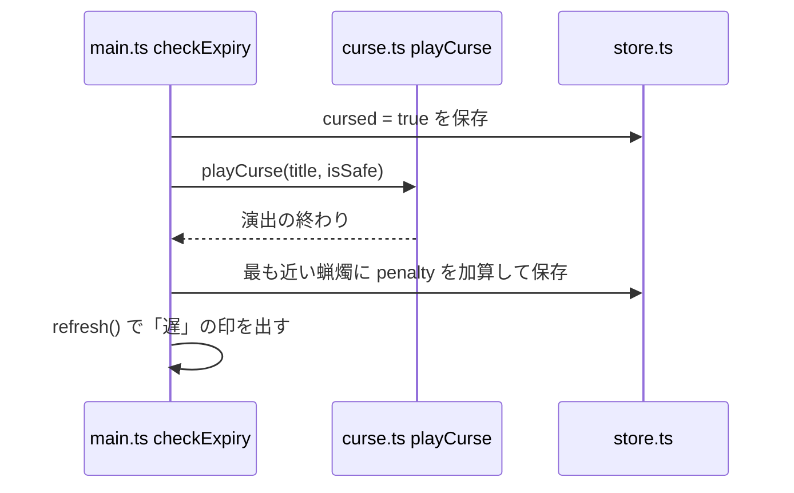

# 設計: 期限切れの呪い

## 構成

| 部品 | 場所 | 役割 |
|---|---|---|
| 期限判定 | `src/main.ts` `checkExpiry()` | 1秒ごとに呼ばれる。保留条件を見て、未呪いの期限切れを1件ずつ処理する |
| 演出 | `src/curse.ts` `playCurse(title, safe)` | 全画面の `#curse` に、暗転から終わりまでを描く。Promise が演出の終わりに解決する |
| 音 | `src/audio.ts` | `candleOut`、`bloodSound`、`startDrone`、`heartbeat`、`lunge` |
| 見た目の罰 | `src/main.ts` `shortenCandle` / `src/store.ts` `visualPct` | `Task.penalty` を増やす。`due` は変えない |

## 流れ

## 演出の段階

| 段階 | 内容 | 長さ | Safe mode |
|---|---|---|---|
| 1 | 暗転と無音 | 1.8秒 | 同じ |
| 2 | 血が上から流れて覆う (22本の柱、遅延と速度はランダム) | 4.6秒 | 同じ |
| 3 | 血が下へ流れ、遠くに女 | 2.6秒 | 女なし。文字へ進む |
| 4 | 暗転を挟みながら近づく | 約8秒 | なし |
| 5 | 静止のあと飛びかかる。閃光、揺れ、衝撃音 | 約1秒 | なし |
| 6 | 黒。「遅かったね」とタイトル。フェードアウト | 約8秒 | 文字のみ |

## 女の描画

- Canvas に毎フレーム描く。髪の束はシード固定の乱数で作り、揺れだけを時間で変える。
- 顔は髪の隙間から片目だけ。口は細い線。正面から見せない。
- 外部画像は使わない。

## データ

`Task.cursed` (再生済みか)、`Task.penalty` (ms、蝋燭が短く見える時間)。`due` は変えない。

## リスクと対応

- ライト表示からの暗転は落差が大きい。目視で確認する (`docs/roadmap.md` の未確認)。
- 長い演出で、ユーザーがタスクを操作できない。保留条件で入力中を守る。スキップ操作は将来の検討。
